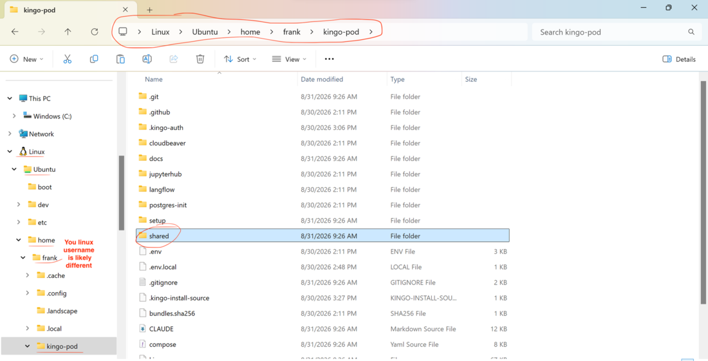
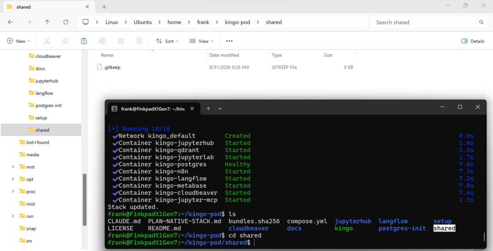

# Kingo Classroom — using the stack on Windows

Setup is done and the script printed `SMOKE OK`. This page is everything that
comes after: your addresses and logins, the handful of commands you need, how
to get your own files in and out, how to update, and what to do when something
goes wrong. Bookmark it — you won't need the setup guide again.

Everything with a `./kingo` in it is typed in the **Ubuntu** app, inside the
`kingo-pod` folder.

> **Jump to:** [Your services](#your-services) ·
> [Everyday use](#everyday-use) · [Modes](#modes-which-services-run) ·
> [Your files](#your-own-files--the-shared-folder) ·
> [Claude Code](#claude-code--your-coding-agent) ·
> [Update](#keeping-up-to-date) ·
> [If something breaks](#if-something-breaks) · [FAQ](#faq)

## Your services

Use your normal **Windows** browser — WSL2 forwards `localhost` from Ubuntu to
Windows automatically. If setup had to move a port your addresses differ from
the defaults below — `./kingo credentials` always prints the truth for your own
laptop:

| Service | Address | Login |
|---|---|---|
| Langflow | <http://localhost:7860> | none (logs in automatically) |
| n8n | <http://localhost:5678> | create your own account on first visit |
| JupyterLab | <http://localhost:8888> | none |
| JupyterHub | <http://localhost:8000> | any username + password `kingo2026` |
| Metabase | <http://localhost:3000> | `admin@kingo.local` / `Kingo2026!` |
| CloudBeaver | <http://localhost:8978> | `student` / `Kingo2026!` — [how to connect](CLOUDBEAVER.md) |
| Qdrant | <http://localhost:6333/dashboard> | none |
| PostgreSQL | `localhost:5432` | `student` / `kingo2026` (db: `classroom`) |

Not all of these run at the same time: in **abp mode** — what setup installs —
only Langflow, n8n, Mail, CloudBeaver, Qdrant and PostgreSQL are on, and
`./kingo credentials` marks the others as *off*. See [Modes](#modes-which-services-run)
for switching.

> **CloudBeaver looks empty at first** ("No Connections") — you have to log in
> via the **gear icon → Login** before the class database shows up, and give it
> the database password once. Two minutes, step by step:
> [Using CloudBeaver](CLOUDBEAVER.md).

MCP (*Model Context Protocol*) is how AI assistants such as Claude Desktop,
Claude Code, or Cursor connect to tools. Point yours at the Jupyter MCP
endpoint `http://localhost:4040/mcp` (header
`Authorization: Bearer kingo-mcp-2026`) and it can write and run code in the
class notebook for you. `./kingo mcp` prints exactly this.

**OpenCode** (AI coding in the terminal) runs inside your Ubuntu — install it
once with:

```bash
curl -fsSL https://opencode.ai/install | bash
```

then run `opencode`. The first run asks for an API key; change it anytime with
`opencode auth login`.

## Everyday use

Open the **Ubuntu** app and go to the class folder:

```bash
cd kingo-pod
```

then one command per job:

| Command | What it does |
|---|---|
| `./kingo up` | start everything (your data stays between runs) |
| `./kingo down` | stop everything |
| `./kingo status` | which services are up? |
| `./kingo credentials` | my addresses + logins |
| `./kingo mode` | which services run — and `./kingo mode full` / `abp` / … switches (see [Modes](#modes-which-services-run)) |
| `./kingo memory` | how much memory the containers have and use |
| `./kingo mail` | set up the mailbox for the mail assistant (n8n workshop); `./kingo mail help` shows the rest |
| `./kingo claude` | start Claude Code, your coding agent, in its sandbox (see [Claude Code](#claude-code--your-coding-agent)) |
| `./kingo claude --login` | the same with your Claude subscription in place of OpenRouter (see [Your Claude subscription](#your-claude-subscription-optional)) |
| `./kingo doctor` | something's wrong? start here |
| `./kingo version` | which version am I running? (send this when you ask for help) |
| `./kingo update` | get the newest class files + images (run it when the instructor announces an update) |

> **What if I just close the Ubuntu window?** Nothing breaks — the stack
> keeps running in the background: your services stay reachable in the
> browser, and it keeps using its memory (about 3 GB in abp mode, up to 6 GB
> in full mode). It stops only when you run
> `./kingo down` or shut down / restart Windows. Your data survives all of
> these — closed windows, `down`, reboots. After a reboot, open Ubuntu and
> run `./kingo up` again. (Docker Desktop users: the stack may come back by
> itself when Docker starts — `./kingo status` shows what's up.)

### Modes: which services run

Not every class week needs all ten services, and an 8 GB laptop cannot run
them all comfortably. A **mode** is the set of services that runs — the
others are simply off (nothing is deleted; every mode keeps your data):

| Mode | What runs | Memory it wants |
|---|---|---|
| `abp` (what setup installs) | Langflow, n8n, Mail, CloudBeaver, Qdrant, PostgreSQL | 4 GB |
| `full` | all ten services | 6 GB |
| `bi` | JupyterLab, JupyterHub, Jupyter MCP, Metabase, CloudBeaver, Qdrant, PostgreSQL | 4.5 GB |
| `langflow` | Langflow, PostgreSQL | 3.5 GB |
| `n8n` | n8n, Mail, PostgreSQL | 2.5 GB |

`./kingo mode` shows the current one. Switching is one line, for example:

```
cd ~/kingo-pod && ./kingo mode full
```

It takes about a minute: the stack stops and comes back with the new set of
services. Your notebooks, dashboards, flows and workflows are all still
there — switch back any time with `./kingo mode abp`.

On Windows there is no memory setting to make: Windows lets WSL use up to
half of the laptop's memory by default (4 GB on an 8 GB laptop) and takes
back whatever the containers do not use. `abp`, `langflow` and `n8n` fit that
default; `bi` and `full` on an 8 GB laptop will run, but slowly — `kingo`
says so when you switch. `./kingo memory` shows what the containers have and
use, and which modes fit.

### Your own files — the `shared` folder

`shared` is a folder inside `kingo-pod` that both you and Langflow can see.
Put your own files there: a SQLite database, a CSV, an Excel sheet, a PDF.

It is one folder with two names, because you and Langflow look at it from
different sides:

| Looking from | The folder is called |
|---|---|
| your laptop (Ubuntu, or File Explorer) | `~/kingo-pod/shared` |
| inside Langflow | `/app/shared` |

So a database you drop in as `~/kingo-pod/shared/trials.sqlite` is
`/app/shared/trials.sqlite` when you type it into a Langflow component. It
works the other way round too: whatever Langflow writes there shows up on your
laptop. The folder is made for you — if it is not there, run `./kingo update`
once.

> **Opening a SQLite file in Langflow?** The SQL component wants a database
> URL, not a path, and an absolute path takes **four** slashes:
> `sqlite:////app/shared/trials.sqlite`.

**Where is the folder in Windows?** Ubuntu's files show up in File Explorer.
Open Explorer and follow the left sidebar:

**Linux → Ubuntu → home → *your Linux user name* → kingo-pod → shared**

Your Linux user name is the one you chose when Ubuntu first started, so your
folder is not called `frank` like the one in the picture. You can also paste
`\\wsl.localhost\Ubuntu\home\` into the address bar and click on from there.



Drag files in and out like in any other folder. Langflow sees them at once.



Quickest way there from Ubuntu — this opens the folder in Explorer:

```bash
cd ~/kingo-pod/shared && explorer.exe .
```

Then right-click **shared** in Explorer's sidebar → **Pin to Quick access**,
and it is one click away from then on.

**Keep private files out of it.** Anything running inside Langflow can read,
change and delete what is in this folder — including a flow someone else built
and you imported. Never let it hold your only copy of something. Nothing
outside this one folder is reachable from Langflow.

> **Using Docker Desktop?** Files that *Langflow itself* writes into the
> folder end up owned by `root` inside Ubuntu — deleting those needs
> `sudo rm`. Files **you** put in are never affected. With Podman (the
> default) this does not happen.

## Claude Code — your coding agent

Claude Code is an AI that works with you in the Ubuntu app. It reads and
writes files, runs commands, and in kingo-pod it can change your n8n
workflows, your Langflow flows and your database. It uses the model GLM 5.3
Flash, paid with the OpenRouter key Yanbo gave you.

It runs in a **sandbox** called nono: on your laptop it can write in one
folder only, `~/kingo-pod/claude`. It can read the rest of `kingo-pod` to
understand the stack, and nothing else on your laptop.

**Install it once.** One line installs the database tool `psql` and Claude
Code (it asks for your Linux password):

```bash
sudo apt install -y postgresql-client && curl -fsSL https://claude.ai/install.sh | bash
```

nono you do not install: `./kingo claude` gets the version it needs by
itself, the first time you start it.

> **Already use Claude Code?** Run the line anyway: it installs Claude Code
> the way Anthropic recommends, or brings it up to date. Your own settings and
> your login stay as they are. Did you install Claude Code in Ubuntu with npm
> instead? Then you now have two installations. `./kingo claude` always takes
> the new one. To
> keep only the new one, remove the old one:
> `npm uninstall -g @anthropic-ai/claude-code`.

**Make a key in n8n for Claude.** In n8n, click **Settings** at the bottom of
the left sidebar, then **n8n API**, then **Create API key**. Label: `claude`.
Expiration: **Never**. Click **Save** and copy the key: n8n shows it only once.

**Start it:**

```bash
cd ~/kingo-pod && ./kingo claude
```

Always start it this way: only `./kingo claude` (or `./kingo yolo`) sets it
up for the course. A plain `claude` is a standard Claude Code with
Anthropic's settings — no sandbox, no keys, your own `~/.claude`.

The first time, it asks for two keys: your OpenRouter key and the n8n key you
just made. Paste each one (right-click in the Ubuntu window) and press Enter;
you do not see a key as you paste it. The key for Langflow it makes by itself.
Then Claude Code asks a few questions of its own: pick a look, and say **Yes**
when it asks whether you trust the folder. To stop, type `/exit`. Every next
time, `./kingo claude` starts it right away.

The first start may also ask **Install them now?** These are a few packages of
Ubuntu that the browser needs, with which Claude looks at the pages it writes.
Press Enter for yes, and type your Linux password.

> **Hard to read?** Type `/theme` in Claude Code and pick another look.
> `/theme` changes only the colors of the text. The background is not Claude
> Code's: it belongs to your terminal, and you change it in the settings of the
> terminal (in the Ubuntu window: the arrow next to the tabs, **Settings**, **Ubuntu**, **Appearance**, **Color scheme**).

**Tell it your team's rules.** Claude reads the file
`~/kingo-pod/claude/AGENTS.md` at every start. Paste your team's copy of
`ws2_rules.html` into it, as the file explains, then start Claude again. This
line opens the file in Notepad:

```bash
cd ~/kingo-pod/claude && notepad.exe AGENTS.md
```

| Claude can | Claude cannot |
|---|---|
| read and write in `~/kingo-pod/claude` | write anywhere else on your laptop |
| read `kingo-pod`: `compose.yml`, the guides | change `kingo-pod`, or run `./kingo` |
| change your n8n workflows, Langflow flows and database | see your keys: it gets stand-ins |
| look things up on the web | see your own Claude Code settings, if you use Claude Code already |
| look at the pages it writes, and click through them | open a web server it starts itself |

**It asks before every command,** unless you start it with
`./kingo yolo`. Inside the sandbox, Claude Code's requests for permission do not
protect your laptop — the sandbox does that either way — but they show you every
change to your workflows, flows and database before it happens. Without them,
save your workflows and flows first with `./kingo backup` (your own tables are
not in it). And only run a command in your
own Ubuntu window if you understand it: Claude cannot leave its sandbox, but a
command you type can.

> **A key stopped working?** `./kingo claude` checks the keys at every start.
> A key that a service refuses is deleted, and the next start asks for it
> again. The keys are kept in `~/.config/kingo/`, where Claude cannot read them.

### Your Claude subscription (optional)

Do you have a Claude subscription (Pro or Max)? Then Claude Code can use it in
place of the OpenRouter key: Anthropic's models, paid by your subscription.
The course does not need this. Everything else stays the same: the sandbox,
n8n, Langflow and the database.

```bash
cd ~/kingo-pod && ./kingo claude --login
```

The first start shows a long address in the Ubuntu window. Copy it, open it in
your browser in Windows, log in to Claude there and allow the access. The page
then shows a code: copy it, paste it into the Ubuntu window (right-click) and
press Enter. The window then says `Logged in.`, and Claude Code starts.
Every next time, `./kingo claude --login` starts Claude Code right away.

- **Back to OpenRouter:** start with `./kingo claude`, as before. Both ways
  stay set up, side by side.
- **One session at a time.** Two sessions with `--login` at once can break the
  login.
- **Claude Code says that you are not logged in?** Run `./kingo claude logout`,
  then start with `--login` again.
- **End the login:** `./kingo claude logout`.

Where the files are:

| What | Where |
|---|---|
| your work | `~/kingo-pod/claude`, the same folder as without `--login` |
| settings and history of the sessions with `--login` | `~/.kingo-claude-login` |
| settings and history of the sessions without it | `~/.kingo-claude` |
| your login | `~/.local/state/nono/oauth-capture` |

The login is kept by nono, outside the sandbox, for up to 90 days. Only you
can read that folder on your laptop; it is not encrypted. Claude Code gets
stand-ins, which are of no use outside the sandbox. To remove the login from
your laptop for good, log out and delete the folder in the Ubuntu window:

```bash
./kingo claude logout && rm -rf ~/.local/state/nono/oauth-capture
```

The folder holds only this login, unless you use nono for other tools too.

## Keeping up to date

**One line brings your installation up to date** — newest class files, images
and rebuilt containers. Safe to run any time in Ubuntu, from any folder:

```bash
cd ~/kingo-pod && ./kingo update
```

Run it whenever your instructor announces an update. It works for every
install, however old — nothing has to be downloaded by hand. Before a new
version starts, it saves a copy of your Langflow flows and n8n workflows in
`kingo-pod/backups/`, so your instructor can bring them back if something
goes wrong.

**Optional this term: Kingo 1.5.** It brings Langflow 1.12, which fixes a
memory bug in Langflow 1.8: chats with the same name share one memory, even
in different flows.
`./kingo update` does not install it by itself. Read
[the optional upgrade to Kingo 1.5](UPGRADE.md) and decide with your team
first.

## If something breaks

**Always start with one command** (in Ubuntu, inside `kingo-pod`) — it checks
the usual suspects and tells you what to do:

```bash
./kingo doctor
```

| What you see | What to do |
|---|---|
| `Cannot connect to the Docker daemon at unix:///run/user/…/podman.sock` | Podman's API socket is off. Run `systemctl --user enable --now podman.socket`, then `./kingo up`. (Current versions of setup and `kingo` do this automatically — `git pull` gets you there.) |
| `Other software on this machine is already using ports Kingo needs` | Run `./kingo fixports`, then `./kingo up`. Kingo moves itself to free ports — your other software is untouched. Your addresses change; `./kingo credentials` shows the new ones. |
| Same message right **after** `./kingo down`, but you started nothing new | No real collision — the port forwarding didn't let go. First just run `./kingo up` again (current `kingo` frees such leftovers where it can — get it: `./kingo update`). If it persists: `./kingo fixports` moves past it, or run `wsl --shutdown` in Command Prompt (Windows) and reopen Ubuntu — **note**: that stops everything running in WSL (including Docker Desktop's backend), not just Kingo. |
| `The Kingo stack is ALREADY RUNNING under your other engine` | Nothing is broken — the stack is up under your other container engine. Follow the two commands the message prints. |
| `ALL of Kingo's ports are busy` | The stack is most likely **already running** (possibly under your other engine). Run `./kingo status` — if services show `up`, you're done, nothing is wrong. |
| I have Docker Desktop, but setup installed Podman | Docker wasn't running or its WSL integration was off during setup. Both engines work — no need to change anything. To switch anyway: turn on WSL integration for Ubuntu, then `./kingo down` (stops the Podman stack **first**), then `echo KINGO_ENGINE=docker >> .env.local`, then `./kingo up`. |
| Laptop feels slow (8 GB machines) | Run a lighter [mode](#modes-which-services-run): `./kingo mode abp` — or, for one tool at a time, `./kingo mode langflow` or `./kingo mode n8n`. Windows, the containers and everything you run share the same 8 GB — above all a browser with dozens of tabs, which alone can take 2–3 GB (the Langflow and n8n tabs count too): close what you do not need. `./kingo down` when you are not using the stack also helps. |
| Ubuntu terminal says `./kingo: No such file or directory` | You're in the wrong folder. Run `cd ~/kingo-pod` first. |
| Anything else | `./kingo down`, then `./kingo up`. If it persists: screenshot the error and ask the instructor / TA. |

## FAQ

**Why Podman and not Docker?** They do the same job and this stack runs
identically on both (our tests run on both, every day). We default to Podman
because it's fully open-source and free for everyone — Docker Desktop's
license requires payment at larger companies, and we don't want the tooling
you learn to expire with your student status. **If Docker Desktop is already
on your laptop, the setup script simply uses it** — you are not missing
anything either way.

**I already use Docker / have my own database. Will this break my stuff?**
No. Kingo runs in its own containers (all named `kingo-…`) with its own
storage. The only possible overlap is a port number — and setup/`fixports`
resolves that automatically by moving *Kingo*, never your software.

**The passwords are printed in a public repo?!** Yes, on purpose. Every
service is reachable **only from your own laptop** (`127.0.0.1` — people on
the same Wi-Fi cannot connect; WSL2's localhost forwarding keeps it that way).
So these are classroom conveniences, not secrets. The one real rule: the class
shares an n8n encryption key, so **never put a real API key into an n8n
workflow you share or export.**

**Where is my data?** Databases, notebooks, and workflows live in container
volumes inside WSL2 and survive `./kingo down`, reboots and mode switches.
Only `./kingo reset` deletes them (it asks first).

**Where did Jupyter and Metabase go?** They are off in `abp` mode, which is
what setup installs — `./kingo status` and `./kingo credentials` say so.
`./kingo mode full` turns everything on (about a minute; see
[Modes](#modes-which-services-run)); the instructor announces when a class
week needs it.

**Can I give the containers more memory?** Not through `kingo`, and on an
8 GB laptop it would not help: whatever WSL takes, Windows no longer has, so
the fix is a lighter mode (`./kingo mode abp`). The half-of-the-laptop limit
is Windows' own setting (a `.wslconfig` file). If you know your way around
that file, changing it is your own project — `kingo` neither needs it nor
touches it.

**Can I use extra Python packages (say, statsmodels)?**

- **JupyterLab** (`:8888`) already ships the data-science standards —
  pandas, statsmodels, scikit-learn, seaborn, and friends. For anything
  else, run `%pip install <package>` in a notebook cell (repeat it if the
  stack was restarted since).
- **Langflow**: the class set (statsmodels, ragas, …) is built in — `import
  statsmodels` just works in Python components. Need one more?
  `./kingo langflow pip install <package>` installs it on the spot; it lasts
  until the next `./kingo down` + `up`, so run it again after that (or ask
  the instructor to add it for everyone). If the install upgraded a compiled
  package (pyarrow, numpy, pandas — pip lists what it installed), run
  `./kingo restart langflow` before building a flow: the running Langflow
  still has the old one loaded, and the build would otherwise fail with
  "size changed, may indicate binary incompatibility".
- **JupyterHub** (`:8000`) starts a minimal Python *without* the data
  packages — use `%pip install` there too, or simply do data work in
  JupyterLab.

**Where are my Windows files inside Ubuntu?** Your Windows drives are mounted
under `/mnt` — e.g. `C:\Users\you\Documents` is `/mnt/c/Users/you/Documents`.

## How it all fits together

```
┌─ Your laptop (Windows) ────────────────────────────────────┐
│                                                            │
│   Browser, KNIME (on Windows)                              │
│       │  always talk to  localhost:<port>                  │
│       ▼  (WSL2 forwards localhost into Ubuntu)             │
│  ┌─ Ubuntu on WSL2 (Windows' built-in Linux) ─────────┐    │
│  │                                                    │    │
│  │   container engine (Podman or Docker) runs one     │    │
│  │   container per service:                           │    │
│  │   [Langflow] [n8n] [JupyterLab] [Metabase] ...     │    │
│  │       │        │                                   │    │
│  │       └────────┴──► [PostgreSQL]   [Qdrant]        │    │
│  │                                                    │    │
│  │   containers reach each other by service NAME:     │    │
│  │   postgres:5432, qdrant:6333                       │    │
│  └────────────────────────────────────────────────────┘    │
└────────────────────────────────────────────────────────────┘
```

Two address rules cover everything:

1. **From your laptop** (Windows browser, KNIME): always `localhost:<port>`.
2. **From one service to another** — e.g. an n8n workflow or Langflow flow
   connecting to the database: use the *service name* as host, **not**
   localhost. PostgreSQL: host `postgres`, port `5432`, database `classroom`,
   user `student`, password `kingo2026`. Qdrant: `http://qdrant:6333`.
   (Inside a container, `localhost` means the container itself — the most
   common mistake. Rule 2 is also why moved host ports never affect
   service-to-service connections.)

## KNIME (optional)

KNIME runs on **Windows** itself, not inside Ubuntu: download **KNIME
Analytics Platform** from <https://www.knime.com/downloads> and install it
like any other program. To use the class database, create a PostgreSQL
connection with host `localhost`, port `5432` (or your moved port from
`./kingo credentials`), database `classroom`, username `student`, password
`kingo2026`. The stack must be running (`./kingo up` in Ubuntu) while you use
it.
